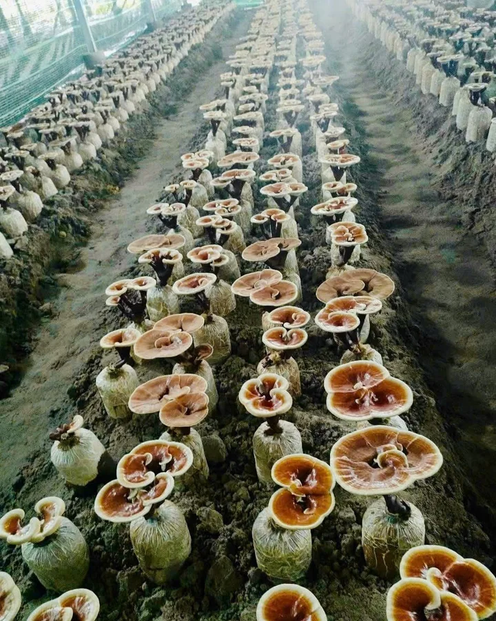
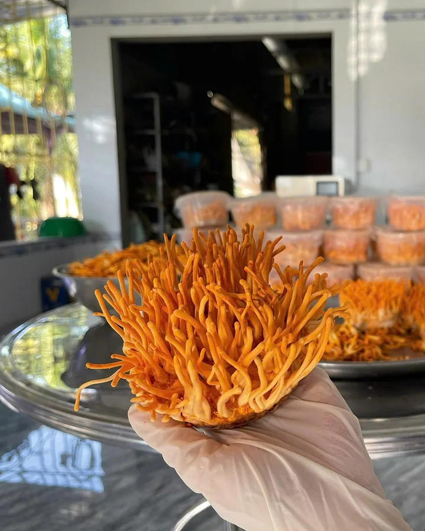
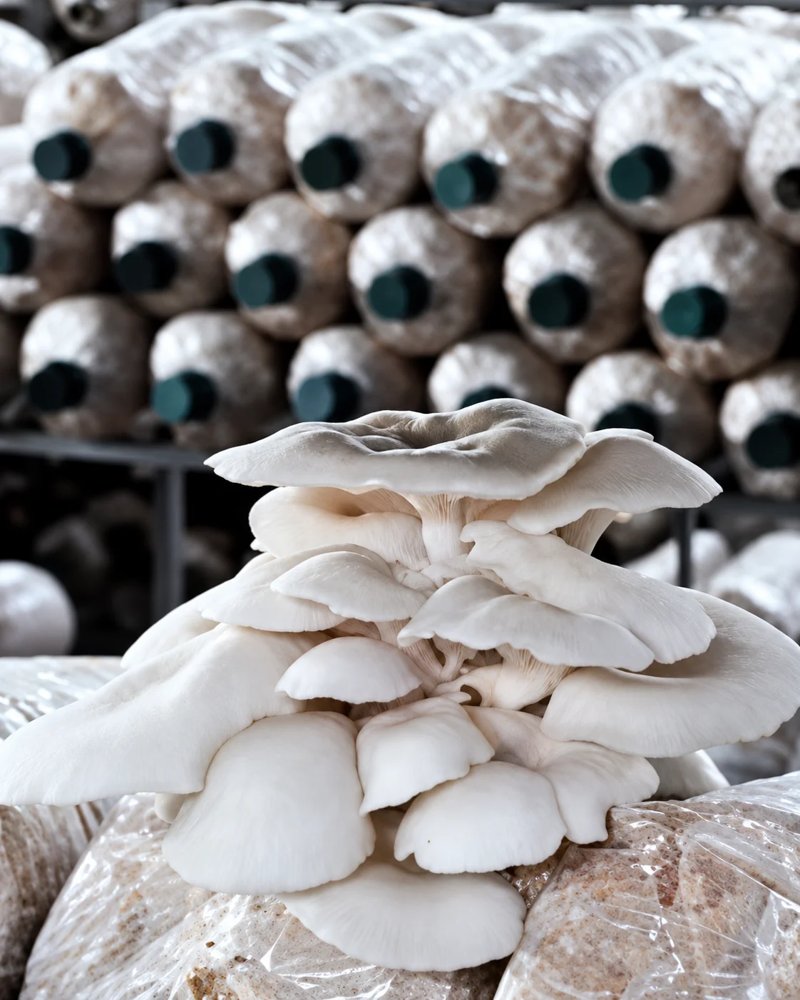

Bên cạnh nấm linh chi, đông trùng hạ thảo và nấm bào ngư, nấm mối đen là một trong bốn dòng nấm chính mà Hiền Nương nuôi trồng tại vùng Bảy Núi, An Giang. Từ vùng Bảy Núi, chị Châu Thị Nương phát triển mô hình trồng nấm gắn với nguồn nguyên liệu nông nghiệp tại địa phương.

## Nấm mối đen

Nấm mối đen mọc lên từ bịch giá thể, được nuôi trồng tại trang trại. Thịt nấm chắc, giòn, vị ngọt thanh và mùi thơm đặc trưng. Đọc thêm: [Nấm mối đen](/chuyen-nha-nam/nam-moi-den/).

## Nấm linh chi

Tai nấm linh chi phát triển từ bịch phôi đặt trên lớp rơm. Sản phẩm giữ nguyên tai nấm lớn, thái lát mỏng để hãm trà hoặc nấu nước. Đọc thêm: [Nấm linh chi tai to](/chuyen-nha-nam/nam-linh-chi-tai-to/).

## Đông trùng hạ thảo

Những sợi đông trùng hạ thảo được nuôi cấy và thu hái tại trang trại. Sợi nấm tươi mọng, vị ngọt thanh, dùng hãm trà, nấu món hoặc ngâm mật ong. Đọc thêm: [Đông trùng hạ thảo tươi](/chuyen-nha-nam/dong-trung-ha-thao-tuoi/).

## Nấm bào ngư

Chùm nấm bào ngư mọc từ bịch phôi xếp trên kệ trong nhà trồng. Tai nấm to, dày thịt, dai giòn và ngọt nước khi xào hay nấu lẩu. Đọc thêm: [Nấm bào ngư](/chuyen-nha-nam/nam-bao-ngu/).

Thông tin từng sản phẩm có ở trang [Sản phẩm](/san-pham/).
