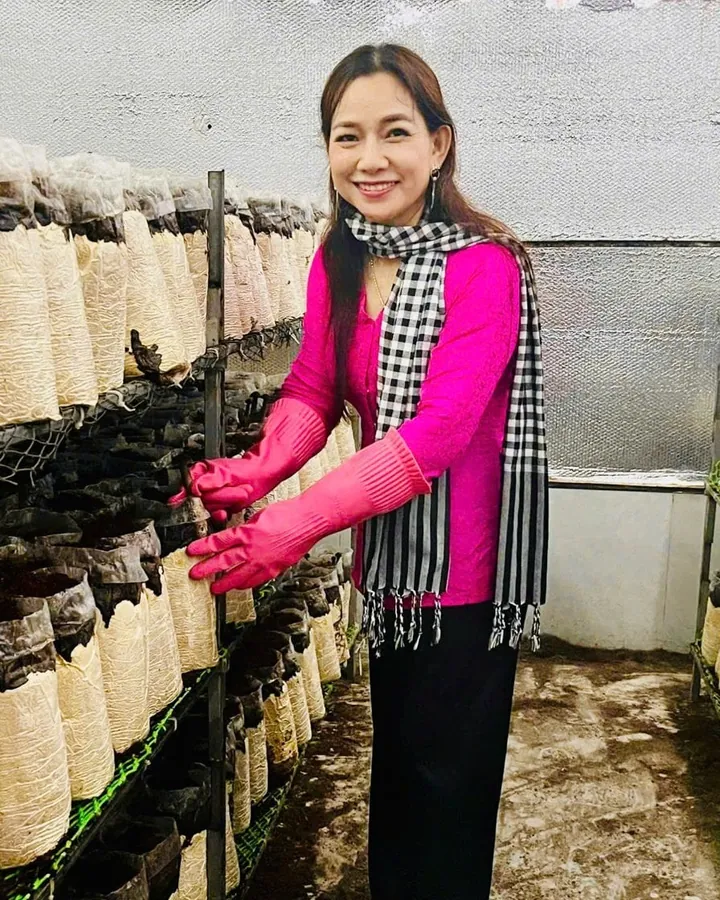

Nấm mối đen Hiền Nương được nuôi trồng tại vùng Bảy Núi, An Giang theo mô hình hữu cơ tuần hoàn khép kín, sử dụng các nguyên liệu tự nhiên như rơm, rạ và cám gạo.

Trang trại có dây chuyền sản xuất phôi nấm khép kín từ khâu làm meo, hấp đến phòng lạnh chạy tơ. Nấm có thịt chắc, giòn, vị ngọt thanh tự nhiên và mùi thơm đặc trưng.

## Từ bịch giá thể đến khay nấm

1. **Chuẩn bị giá thể.** Rơm và các phụ phẩm nông nghiệp tại địa phương được tận dụng để tạo giá thể trồng nấm.
2. **Đóng bịch.** Giá thể được đóng vào bịch, đậy nắp và xếp vào khay sắt.
3. **Nuôi trồng trên kệ.** Các bịch được xếp thành từng dãy trên kệ trong nhà trồng.
4. **Chăm sóc và thu hái.** Người làm nấm theo dõi các bịch trên kệ cho đến khi nấm được thu hái.
5. **Tái sử dụng giá thể.** Sau mỗi vòng trồng nấm, giá thể tiếp tục được tận dụng trong các công đoạn nông nghiệp khác, như nuôi trùn quế và tạo phân hữu cơ.

Nấm tươi được thu hoạch, tuyển chọn, đóng khay và hút chân không.

## Thông tin ngắn

- **Vùng nuôi trồng:** Bảy Núi, An Giang
- **Mô hình:** Nông nghiệp hữu cơ tuần hoàn khép kín
- **Thành phần:** 100% nấm mối đen tươi nuôi trồng hữu cơ
- **Kiểm nghiệm mẫu:** VietLabs, 2023 (tên mẫu ghi trên báo cáo là “Nấm mối”)

Cách dùng và bảo quản: [Nấm mối đen vào bếp](/chuyen-nha-nam/nam-moi-den-vao-bep/). Trang sản phẩm: [Nấm Mối Đen](/san-pham/nam-moi-den/).
