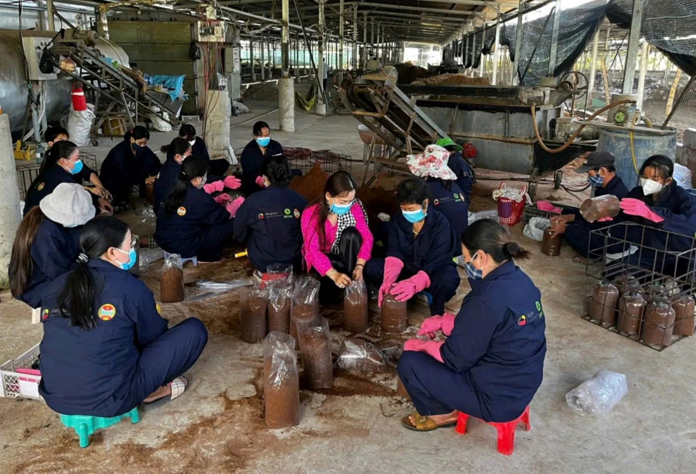
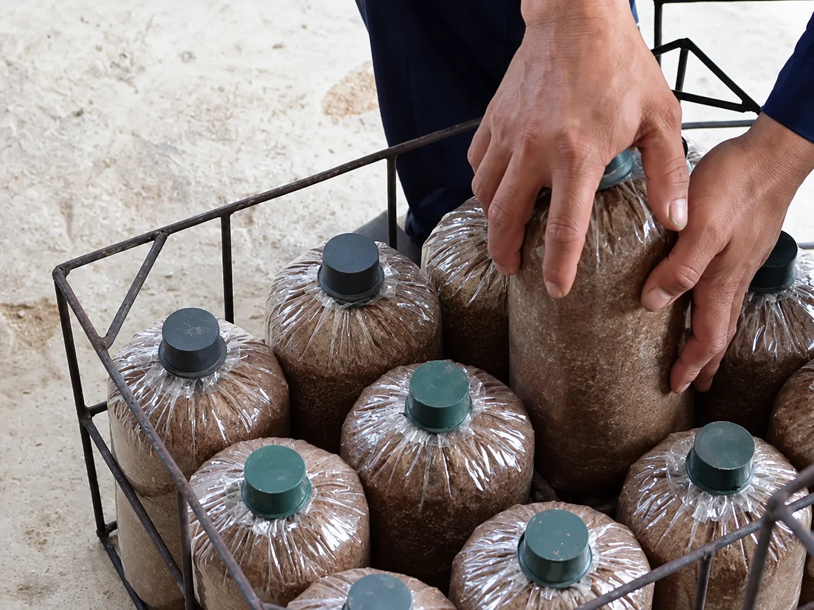
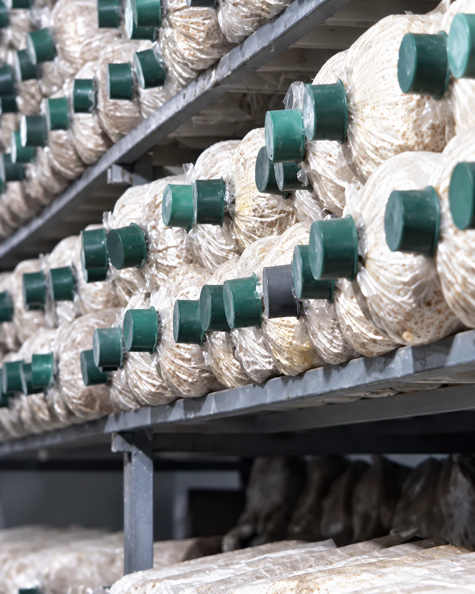

Sau mỗi vụ lúa, nguồn rơm rạ tại địa phương được tận dụng làm nguyên liệu trồng nấm mối đen. Thay vì bỏ đi, phụ phẩm nông nghiệp trở thành đầu vào cho một chu kỳ sản xuất mới tại Hiền Nương.

## Phụ phẩm nông nghiệp

Nguồn nguyên liệu gồm rơm, trấu, cám và mùn cưa được kiểm tra trước khi sử dụng, chuẩn bị cho công đoạn xử lý và phối trộn giá thể. Từ những vật liệu quen thuộc của đồng ruộng, trang trại tạo thêm giá trị qua mô hình nuôi trồng nấm.

## Chuẩn bị giá thể

Rơm được băm nhuyễn, phối trộn cùng cám gạo, cám bắp để tạo thành giá thể trồng nấm. Hỗn hợp được đóng vào từng bịch và hấp xử lý trước khi cấy meo.

Độ mịn, độ ẩm và chất lượng nguyên liệu được kiểm soát trong quá trình chuẩn bị. Giá thể sau xử lý là môi trường cung cấp dinh dưỡng để tơ nấm phát triển ở bước tiếp theo.

## Cấy meo và ủ phôi

Meo nấm được cấy vào giá thể đã xử lý, sau đó các bịch được đưa vào giai đoạn ủ để tơ nấm phát triển. Khi tơ lan dần trong giá thể, bịch chuyển thành phôi nấm để phục vụ nuôi trồng.

Hiền Nương chủ động sản xuất meo giống và phôi tại cơ sở, theo dõi quá trình phát triển và kiểm tra chất lượng trước khi đưa phôi vào nhà trồng hoặc cung ứng cho người có nhu cầu. Việc chủ động từ khâu giống giúp trang trại kiểm soát đầu vào và đồng hành cùng người trồng bằng hướng dẫn kỹ thuật.

## Nuôi trồng và thu hoạch

Sau giai đoạn phát triển tơ, phôi nấm mối đen được mở nắp và phủ lớp cát đã làm sạch, khử trùng. Nhà trồng được duy trì độ ẩm và nhiệt độ phù hợp, kết hợp phun sương bằng nước sạch để hỗ trợ nấm phát triển.

Nấm được theo dõi và thu hoạch qua nhiều đợt trong một chu kỳ nuôi trồng. Khi chu kỳ kết thúc, phần giá thể còn lại được chuyển sang công đoạn tận dụng tiếp theo, câu chuyện được kể tiếp trong bài [Sau mùa nấm, giá thể về với đất](/chuyen-nha-nam/sau-mua-nam-gia-the-ve-voi-dat/).

Cả sáu bước của vòng tuần hoàn có trên trang [Nông nghiệp tuần hoàn](/nong-nghiep-tuan-hoan/).
